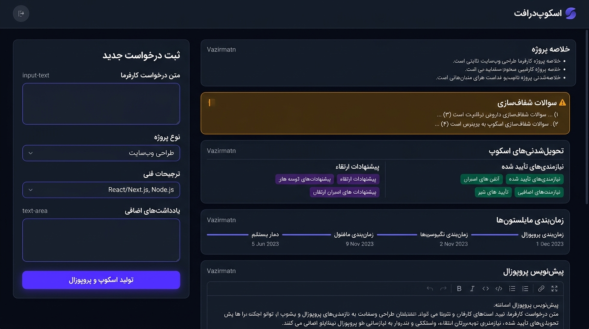

# ScopeDraft 🚀
### AI-Powered Project Scope & Proposal Generator for Freelancers and Agencies
#### دستیار هوشمند تنظیم اسکوپ و پیش‌نویس پروپوزال رسمی برای برنامه‌نویسان فریلنسر و شرکت‌های نرم‌افزاری

<p align="center">
  
</p>

---

## 💡 The Core Problem (مشکل اصلی)

**English:**  
Freelancers and boutique software agencies constantly receive vague, fragmented, or ambiguous client inquiries (via Telegram, WhatsApp, email, or brief meeting notes). Turning these chaotic messages into crystal-clear project scopes and formal proposals wastes hours of unbillable time and frequently leads to devastating **scope creep** or budget disputes.

**فارسی:**  
برنامه‌نویسان فریلنسر و تیم‌های نرم‌افزاری همواره با درخواست‌های مبهم، ناقص و آشفته از سوی کارفرمایان در پیام‌رسان‌ها، ایمیل یا جلسات اولیه مواجه می‌شوند. تبدیل این پیام‌های نامنظم به یک محدوده پروژه (Scope) شفاف، ساعت‌ها زمان می‌برد و در صورت شفاف نشدن نیازمندی‌ها، منجر به **اسکوپ کریپ (افزایش بی‌رویه تعهدات)**، کار اضافه بدون دستمزد و اختلافات مالی می‌شود.

---

## ✨ Key Features (ویژگی‌های کلیدی)

- 🔍 **1. Objective Request Summary (خلاصه درک نیاز کارفرما):** Synthesizes what the client is actually asking for in plain technical terms.
- ❓ **2. Clarification Questions (سوالات شفاف‌سازی و ابهامات کلیدی):** Identifies critical missing requirements and unstated technical/business logic before quoting prices.
- 🎯 **3. Scope Breakdown (تفکیک دقیق تعهدات):**
  - **Confirmed Deliverables:** Explicitly requested by the client.
  - **Suggested Enhancements:** Architectural recommendations and best practices, strictly labeled as optional.
- 📅 **4. Milestones & Dependencies (فازبندی اجرایی و نیازمندی‌ها):** Structured stages with prerequisite client assets and approvals.
- 🛡️ **5. Freelancer Defense Shield (سپر دفاعی فریلنسر):** Explicitly outlines assumptions, **out-of-scope exclusions** (e.g. content entry, server fee, third-party SMS costs), and project risks.
- 📝 **6. Editable Proposal Draft (پیش‌نویس آماده پروپوزال با قابلیت ویرایش زنده):** Generates a ready-to-send polite business proposal with inline editing, word count, one-click copy, and `.md` file download.
- 🌐 **7. Bilingual Support (فارسی و انگلیسی):** Clean Persian RTL layout with an instant toggle to generate the output in professional Business English.
- ⚡ **8. Realistic Pre-loaded Samples:** Includes realistic real-world project inquiries (e.g. 3-branch bakery online ordering, clinic appointment booking) for immediate 1-click testing.

---

## 🔒 Strict Anti-Hallucination Integrity (قواعد عدم توهم مالی و زمانی)

ScopeDraft adheres to strict prompt engineering rules:
1. **Never invents a price, budget, or hourly rate** if the client didn't specify one. Instead, it places transparent placeholders like `[مبلغ پس از شفاف‌سازی سوالات فوق تعیین می‌گردد]` or `[TBD upon clarifying questions]`.
2. **Never fabricates an arbitrary deadline** (e.g. "4 weeks") unless requested.
3. Clearly distinguishes client commitments from technical recommendations.

---

## 🛠️ Tech Stack (فناوری‌های استفاده‌شده)

- **Frontend:** React 19, TypeScript, Tailwind CSS, Lucide React icons, Vazirmatn typography
- **Backend:** Express full-stack server with Vite middleware integration
- **AI Engine:** Google Gemini API (`@google/genai`) powered by `gemini-3.8-flash`
- **Security:** Complete server-side API proxy (API keys are never exposed to browser bundles)

---

## 🚀 Getting Started (نحوه راه‌اندازی و اجرا)

### 1. Clone the repository
```bash
git clone https://github.com/your-username/scopedraft.git
cd scopedraft
```

### 2. Install dependencies
```bash
npm install
```

### 3. Configure environment variables
Create a `.env` file in the root directory:
```env
GEMINI_API_KEY="your_gemini_api_key_here"
PORT=3000
```

### 4. Run the development server
```bash
npm run dev
```

Visit `http://localhost:3000` in your browser.

---

## ☁️ Deploying to Vercel (استقرار روی ورسل)

The repository is pre-configured for instant zero-configuration deployment to Vercel:

1. Import your GitHub repository into [Vercel](https://vercel.com).
2. Framework Preset will be automatically detected as **Vite**.
3. Under **Environment Variables**, add:
   - `GEMINI_API_KEY`: Your Google Gemini API key.
4. Click **Deploy**. Vercel will build the frontend via Vite (`dist`) and automatically deploy `/api/generate` and `/api/health` as Vercel Serverless Functions.

---

## 📂 Project Structure

```text
├── src/
│   ├── assets/
│   │   └── images/
│   │       └── scopedraft_app_ui_1792660821622.jpg   # Application preview image
│   ├── App.tsx                                      # Full interactive UI & state
│   ├── main.tsx                                     # React entry point
│   └── index.css                                    # Tailwind & typography setup
├── server.ts                                        # Secure Express backend & Gemini API
├── package.json
├── tsconfig.json
├── vite.config.ts
└── README.md
```

---

## 📄 License
MIT License. Built for freelance software developers and agencies.
